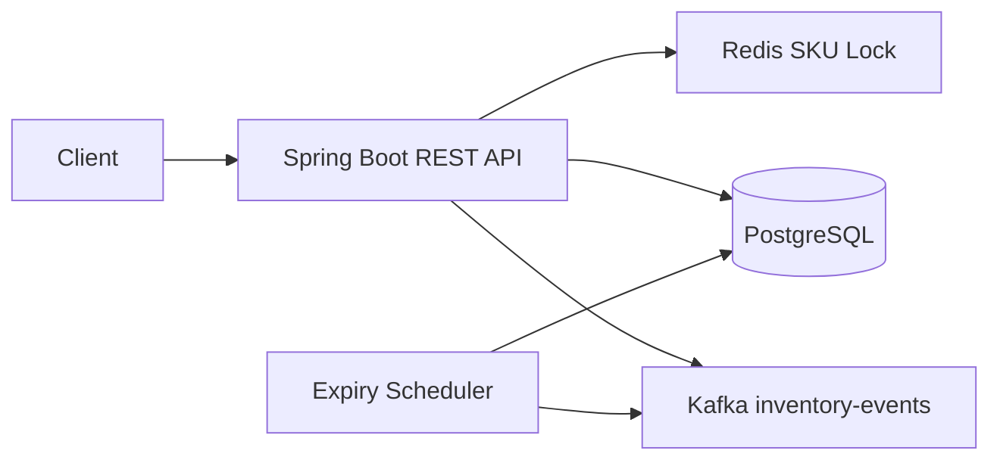

# FlashStock Architecture

## Correctness strategy
1. Idempotency key prevents duplicate reservation creation.
2. Redis serializes short bursts for the same SKU.
3. PostgreSQL pessimistic row lock protects the inventory row.
4. Transaction commits stock and reservation together.
5. Kafka publishes domain events for asynchronous consumers.
